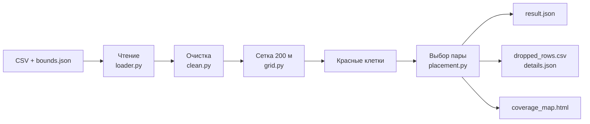

# Как это работает

Документ для команды: прочитайте его целиком перед защитой. За ответы на вопросы дают 10 баллов,
и жюри проверяет, что вы понимаете свой код.

## В двух словах

У нас 5000 замеров сигнала по району Бишкека. Мы выкидываем 200 битых строк, делим район на клетки
200×200 м, в каждой считаем медиану сигнала и красим клетку зелёным, жёлтым или красным.
Затем из 20 площадок выбираем две, которые вместе накрывают радиусом 1 км больше всего красных клеток.

**На открытых данных организаторов результат совпадает с их `expected.json` полностью** — все четыре
поля, включая медианы худших клеток (`python check.py out/result.json data/expected.json`).



## Входные данные

| Файл | Что это | Поля |
|---|---|---|
| `measurements.csv` | замеры сигнала | `lat`, `lon`, `rsrp_dbm`, `timestamp` |
| `towers.csv` | существующие базовые станции (БС) | `id`, `lat`, `lon` |
| `candidates.csv` | 20 мест, где можно поставить новую БС | `id`, `lat`, `lon` |
| `bounds.json` | границы района, начало сетки, размер клетки, радиус Земли, часовой пояс | |

**RSRP** — мощность сигнала LTE в дБм. Чем ближе к нулю, тем лучше: −70 — отлично, −110 — почти
нет связи. Значения отрицательные, поэтому «меньше» означает «хуже».

Все правила ниже взяты из `CLARIFICATIONS_RU.md` организаторов (п. 7 «Покрытие»).

## Шаг 1. Чтение — `covmap/loader.py`

Мы читаем CSV модулем `csv` и получаем все значения как строки, а не используем `pandas.read_csv`.

**Почему так:** в скрытых данных жюри заложен мусор. `read_csv` падает на строке с лишними полями,
молча пропускает пустые строки и путает типы колонок, и тогда счёт отброшенных строк разойдётся
с эталоном. Мы читаем каждую строку как есть, запоминаем её номер в файле, а решение «выбросить или
оставить» принимаем на следующем шаге. Пустая строка в файле тоже считается отброшенной — так
требуют уточнения.

## Шаг 2. Очистка — `covmap/clean.py`

Проверки идут в том порядке, который задали организаторы. Каждая строка отбрасывается один раз —
по первой сработавшей причине.

| № | Правило | Пример выброшенной строки | Открытые данные |
|---|---|---|---|
| 1 | Поле пустое, не число, `NaN`, `Infinity` | `42.87, 74.6, bad` | 30 |
| 2 | Время не в формате ISO 8601 | `bad-time`, пусто | 10 |
| 3 | RSRP вне −140…−44 (границы включительно) | `-150`, `0` | 25 |
| 4 | Координаты вне границ района (включительно) | точка за пределами `bounds.json` | 30 |
| 5 | Дубль по четырём **нормализованным** полям | повтор строки 120 | 105 |

- **Нормализация для дублей:** числа сравниваются как числа (`-90` и `-90.0` — одно и то же),
  время — как момент времени (`14:00+06:00` и `08:00Z` — одно и то же). Время переводится
  в местный пояс `Asia/Bishkek`.
- **Итог `dropped_rows` не зависит от порядка правил**, потому что в итоге остаются ровно уникальные
  валидные строки. Порядок влияет только на разбивку по причинам.

Итого 200 из 5000, остаётся 4800 замеров. Каждая выброшенная строка с номером и причиной лежит
в `out/dropped_rows.csv`.

## Шаг 3. Сетка 200×200 м — `covmap/grid.py`

Формула из уточнений организаторов. Начало сетки (lat0, lon0) = (42.84, 74.56) из `bounds.json`,
R = 6 371 000 м:

```
x = R · cos(lat0) · rad(lon − lon0)       — метры на восток
y = R · rad(lat − lat0)                   — метры на север
ix = floor(x / 200),  iy = floor(y / 200)
cell_id = X{ix:03d}_Y{iy:03d}
```

Пример: точка `42.8653, 74.5781` → x = 1475.8 м, y = 2813.2 м → ix = 7, iy = 14 → клетка **`X007_Y014`**.

Такая проекция называется локальной равнопромежуточной. Центр клетки — (ix + 0.5, iy + 0.5) · 200 м,
переведённые обратно в широту и долготу.

Дальше для каждой клетки:
- считаем **медиану** RSRP (не среднее: медиана устойчива к выбросам);
- клетки, где **меньше 5 замеров**, не учитываем. Замеры есть в 398 клетках, 11 из них отсеиваются,
  остаётся **387**;
- красим: **зелёный ≥ −90**, **жёлтый от −105 до −90**, **красный < −105**. Красных — **174**.

**Топ-3 худших** — три клетки с самой низкой медианой, при равенстве — по `cell_id`:
`X006_Y013` (−124.5), `X005_Y013` (−121.4), `X006_Y012` (−120.75).

## Шаг 4. Выбор двух площадок — `covmap/placement.py`

1. **Отсеиваем площадки ближе 500 м к любой существующей БС.** Расстояние по формуле гаверсинуса,
   R = 6 371 000 м. На открытых данных C01–C04 стоят ровно на месте БС B01–B04 и отсеиваются.
2. **Для каждой оставшейся площадки находим красные клетки, центр которых не дальше 1 км.**
   Получается множество клеток.
3. **Перебираем все пары.** Из 16 площадок получается 16×15/2 = **120 пар**. Для каждой считаем
   размер **объединения** двух множеств — это и есть «без двойного учёта»: клетка, которую
   накрывают обе площадки, считается один раз.
4. Побеждает пара с самым большим объединением. При равенстве — лексикографически минимальная пара ID.

Ответ: **C09 + C14 закрывают 111 из 174 красных клеток.**

### Почему не жадный алгоритм (бонус ТЗ)

Жадный берёт сначала лучшую одиночную площадку, потом ту, что добавляет больше всего.
**На открытых данных он ошибается:** берёт C16 (+74 клетки — лучшая в одиночку), потом C17 (+34)
и получает **108**. Полный перебор находит C09 + C14 — **111**. Две «средние» площадки, которые
дополняют друг друга, лучше, чем самая сильная плюс лучшее к ней.

Тот же эффект на игрушечном примере (есть в тестах, `test_greedy_can_be_suboptimal`):

| Площадка | Накрывает клетки |
|---|---|
| X | 2, 3, 4, 5 |
| Y | 1, 2, 3 |
| Z | 4, 5, 6 |

Жадный берёт X (4), потом Y или Z добавляет ещё одну — итого **5**. Правильный ответ — Y + Z = **6**.

## Шаг 5. Что получается на выходе

- `out/result.json` — то, что проверяет автопроверка. Формат как в `expected.json` организаторов:
  `worst_cells` — список объектов `{cell_id, rsrp_median}`.
- `out/dropped_rows.csv` — каждая выброшенная строка: номер строки в исходном файле, причина
  («повтор строки 120», «RSRP −150 вне [−140; −44]», «timestamp='bad-time' не ISO 8601»).
- `out/details.json` — всё для разбора: разбивка очистки, координаты худших клеток,
  отклонённые площадки, жадный против перебора, день и ночь.
- `out/coverage_map.html` — карта, `out/tour.html` — она же сразу в туре.

## Карта

- **Чек-лист «ТЗ 7 — выполнено»** — первый блок панели. 5 обязательных пунктов и 3 бонуса, у каждого
  живая цифра. Клик по пункту запускает тур с этого шага.
- **Шкала RSRP** — сколько клеток с какой медианой, пунктиры на −105 и −90. Наведите курсор
  на клетку — по шкале пробежит стрелка с её значением. Плашки под шкалой прячут класс на карте.
- **«Новые базовые станции»** — выбранная пара и полоса «закрыто / остаются».
- **«Площадки»** — клик выбирает площадку в пару (на карте тоже). Серые с крестиком — ближе 500 м к БС.
- **Переключатели над картой:** «День / Ночь / Разница» (подсвечены клетки, сменившие цвет),
  «После 2 БС» (закрытые клетки фиолетовые, «174 → 63»), «Замеры», «Тепловая карта», «Зоны 500 м».
- **Фиолетовый цвет** — всё, что относится к новым станциям.
- Leaflet встроен в HTML: без интернета пропадёт только подложка с улицами.

## Тур по ТЗ

Кнопка «Показать, как мы считали» (или `run.bat data --tour`). Карта на весь экран, внизу крупная
плашка: пункт ТЗ, что сделано, одна большая цифра. Листать: `→` / `Пробел` / `PageDown`, назад `←`,
выход `Esc`. Кликер для презентаций тоже работает.

| Шаг | Пункт ТЗ | Что происходит на карте |
|---|---|---|
| 1 | Очистка данных | Все точки, мусорные — красные; они исчезают, счётчик «−200» |
| 2 | Сетка 200 м, медиана | Проступает сетка, точки «схлопываются» в клетки |
| 3 | Цвета | Клетки волной окрашиваются в зелёный / жёлтый / красный |
| 4 | Топ-3 худших | Карта облетает три худшие клетки |
| 5 | Две площадки | C01–C04 перечёркнуты («0 м до B01»), раскрываются круги 1 км, закрытые клетки становятся фиолетовыми, «111/174» |
| 6 | Бонус: жадный против перебора | Жадный C16 + C17 = 108 пунктиром, перебор C09 + C14 = 111, график всех 120 пар |
| 7 | Бонус: день и ночь | Подсвечены только клетки, сменившие цвет (45) |
| 8 | Бонус: тепловая карта | Тепловая карта слабого сигнала |
| 9 | Итог | Чек-лист 8/8 с галочками |

## Как будет проверять жюри

1. Склонируют репозиторий и запустят команду из README на **скрытом** наборе данных с мусором.
2. Сравнят `out/result.json` с эталоном:
   - пара площадок — должна совпасть точно;
   - `dropped_rows` — допустимо отклонение ±5%;
   - худшие клетки — должны совпасть хотя бы 2 из 3.
3. Если код не запустился — 0 баллов за функциональность (это 40 из 100).

Мы повторили эту проверку в `check.py`. На открытых данных:

```
ЗАЧЁТ    Пара площадок: получено ['C09', 'C14'], эталон ['C09', 'C14']
ЗАЧЁТ    Отброшенные строки ±5%: получено 200, эталон 200, отклонение +0.0%
ЗАЧЁТ    Худшие квадраты ≥ 2 из 3: совпало 3
совпало  covered_weak_cells: получено 111, эталон 111
совпало  Медианы худших квадратов
```

## Частые вопросы жюри

**Почему медиана, а не среднее?**
Так требует ТЗ, и это правильно: один выброс −140 сильно тянет среднее, а медиану почти не двигает.

**Почему полный перебор, а не что-то умнее?**
Пар максимум 190. Перебор точен и укладывается в миллисекунды. Жадный мы тоже реализовали —
и на ваших же данных он даёт 108 вместо 111.

**А если бы площадок было 10 000?**
Тогда пар ~50 млн. Можно сначала выкинуть площадки, не накрывающие ни одной красной клетки,
а для выбора k > 2 площадок — использовать жадный (у него гарантия ≥ 63% от оптимума) или
целочисленное программирование.

**Почему гаверсинус, а не теорема Пифагора по градусам?**
Градус долготы в Бишкеке короче градуса широты (~81,6 км против 111 км). Пифагор по градусам
ошибся бы на десятки процентов. Гаверсинус считает расстояние по поверхности шара.

**Как вы считаете дубли?**
По всем четырём полям после нормализации: числа как числа, время как момент в поясе Asia/Bishkek.
Поэтому `-90` и `-90.0`, `14:00+06:00` и `08:00Z` — одинаковые значения.

**Что будет, если в файле мусор, которого вы не ждали?**
Всё, что не разбирается как число или как ISO-время, отбрасывается с причиной. Программа не падает:
это проверено тестами на пяти случайных наборах с мусором и на открытом наборе организаторов.

**Откуда границы и сетка?**
Из `bounds.json`, который лежит рядом с данными, — программа находит его сама. Можно передать
другой файл флагом `--bounds-file`.

**Как вы проверяли, что код правильный?**
50 тестов, среди них — точное совпадение с `expected.json` организаторов по всем четырём полям.
Плюс генератор данных с заранее известным количеством мусора: на нём число отброшенных строк
совпадает точно, по каждой причине и построчно в `dropped_rows.csv`.

## Сценарий демо (3 минуты)

1. **(15 с) Задача.** «Где в Бишкеке слабый сигнал и куда поставить две новые станции».
2. **(15 с) Запуск.** `run.bat data --tour` — за 2 секунды расчёт, и сразу открывается тур.
   «Результат совпадает с вашим открытым эталоном по всем четырём полям».
3. **(2 мин) Тур.** Листаете стрелкой 9 шагов, на каждом — одна фраза своими словами.
   Шаг 5: «C01–C04 стоят прямо на месте существующих БС — правило 500 м их отсекает».
   Шаг 6: «Жадный берёт самую сильную площадку и получает 108, перебор — 111».
4. **(20 с) Живая карта.** `Esc`, кликнуть свою пару — «на N меньше оптимума».
5. **(10 с) Надёжность.** «50 тестов, `check.py` повторяет вашу автопроверку, каждая выброшенная
   строка — в `dropped_rows.csv` с причиной».
