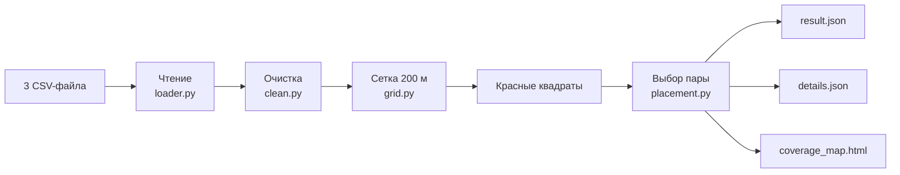

# Как это работает

Документ для команды: прочитайте его целиком перед защитой. За ответы на вопросы дают 10 баллов,
и жюри проверяет, что вы понимаете свой код.

## В двух словах

У нас есть ~5000 замеров сигнала по Бишкеку. Мы выкидываем битые строки, делим город на квадраты
200×200 м, в каждом считаем медиану сигнала и красим квадрат зелёным, жёлтым или красным.
Затем из 20 площадок выбираем две, которые вместе накрывают радиусом 1 км больше всего красных квадратов.



## Входные данные

| Файл | Что это | Поля |
|---|---|---|
| `measurements.csv` | замеры сигнала телефоном | `lat`, `lon`, `rsrp_dbm`, `timestamp` |
| `towers.csv` | существующие базовые станции (БС) | `id`, `lat`, `lon` |
| `candidates.csv` | 20 мест, где можно поставить новую БС | `id`, `lat`, `lon` |

**RSRP** — мощность сигнала LTE в дБм. Чем ближе к нулю, тем лучше: −70 — отлично, −110 — почти
нет связи. Значения отрицательные, поэтому «меньше» означает «хуже».

## Шаг 1. Чтение — `covmap/loader.py`

Мы читаем CSV модулем `csv` и получаем все значения как строки, а не используем `pandas.read_csv`.

**Почему так:** в скрытых данных жюри заложен мусор. `read_csv` падает на строке с лишними полями
или молча пропускает её, и тогда счёт отброшенных строк разойдётся с эталоном. Мы читаем каждую
строку как есть, а решение «выбросить или оставить» принимаем на следующем шаге.

Заодно поддерживаются: BOM в начале файла, разделитель `;`, заголовки в другом регистре и синонимы
(`latitude` → `lat`, `rsrp` → `rsrp_dbm`).

## Шаг 2. Очистка — `covmap/clean.py`

Правила применяются по порядку. Каждая строка отбрасывается один раз — по первой сработавшей причине.

| № | Правило | Пример выброшенной строки |
|---|---|---|
| 1 | Координаты или RSRP не число / пусто / `inf` | `42.87, 74.6, abc` |
| 2 | Дубль уже встреченной строки | вторая копия `42.87, 74.6, -95, 2026-11-01 10:00` |
| 3 | RSRP вне диапазона −140…−44 (границы включительно) | `-150`, `0`, `-43` |
| 4 | Координаты вне границ района | `0, 0`, перепутанные `74.6, 42.87` |

- **Дубль** — строка, у которой совпадают все четыре поля. Числа сравниваются после разбора, поэтому
  `-90` и `-90.0` считаются одинаковыми.
- **Итог `dropped_rows` не зависит от порядка правил**, потому что в итоге остаются ровно уникальные
  валидные строки. Порядок влияет только на разбивку по причинам.
- **Битое время — не повод выбрасывать строку.** В ТЗ такого правила нет. Такие строки участвуют
  в карте, но не в сравнении дня и ночи.

На тестовых данных: 5000 строк, отброшено 180 (30 не числа, 80 дублей, 40 вне диапазона, 30 вне района).

## Шаг 3. Сетка 200×200 м — `covmap/grid.py`

Нужно понять, в какой квадрат попадает точка. Начало сетки — юго-западный угол района (42.78, 74.45).

- 1° широты = 111 195 м, значит 200 м = **0.0017986°** широты.
- 1° долготы на широте Бишкека короче: 111 195 × cos(42.865°) ≈ 81 500 м, значит 200 м = **0.0024539°** долготы.

```
строка  = floor((lat − 42.78) / 0.0017986)
столбец = floor((lon − 74.45) / 0.0024539)
```

Пример: точка `42.8700, 74.6000` → строка 50, столбец 61 → квадрат `r50_c61`.

Такая проекция называется локальной равнопромежуточной. На районе ~20 км ошибка меньше 0,1%,
а формулу можно проверить на калькуляторе.

Дальше для каждого квадрата:
- считаем **медиану** RSRP (не среднее: медиана устойчива к выбросам);
- квадраты, где **меньше 5 замеров**, не учитываем;
- красим: **зелёный ≥ −90**, **жёлтый от −105 до −90**, **красный < −105**.

**Топ-3 худших** — три квадрата с самой низкой медианой. При равенстве выше тот, где больше замеров.

## Шаг 4. Выбор двух площадок — `covmap/placement.py`

1. **Отсеиваем площадки ближе 500 м к существующей БС.** Расстояние считаем по формуле гаверсинуса,
   то есть по поверхности шара Земли. На тестовых данных отсеялись 3 из 20.
2. **Для каждой площадки находим красные квадраты в радиусе 1 км** до центра квадрата. Получается
   множество, например `C14 → {r32_c79, r33_c80, …}` (15 квадратов).
3. **Перебираем все пары.** Из 17 площадок получается 17×16/2 = **136 пар**. Для каждой считаем
   размер **объединения** двух множеств. Объединение и есть «без двойного учёта»: квадрат, который
   накрывают обе площадки, считается один раз.
4. Побеждает пара с самым большим объединением. При равенстве — первая по порядку в файле.

Перебор занимает миллисекунды и **гарантирует точный ответ**.

### Почему не жадный алгоритм (бонус ТЗ)

Жадный берёт сначала лучшую одиночную площадку, потом ту, что добавляет больше всего. Он быстрее,
но может ошибиться:

| Площадка | Накрывает квадраты |
|---|---|
| X | 2, 3, 4, 5 |
| Y | 1, 2, 3 |
| Z | 4, 5, 6 |

Жадный берёт X (4 квадрата), потом Y или Z добавляет ещё один — итого **5**. Правильный ответ —
Y + Z = **6**. Этот пример есть в тестах (`test_greedy_can_be_suboptimal`), а на карте показано,
совпал ли жадный с перебором на реальных данных.

## Шаг 5. Что получается на выходе

- `out/result.json` — то, что проверяет автопроверка. Ровно четыре поля из ТЗ.
- `out/details.json` — всё для разбора: причины отбраковки, координаты худших квадратов,
  отклонённые площадки, жадный против перебора, день и ночь.
- `out/coverage_map.html` — карта (как ей пользоваться — ниже).

## Карта

- **Шкала слева вверху** — сколько квадратов с какой медианой. Пунктиры на −105 и −90 — пороги цветов.
  Наведите курсор на квадрат на карте, и по шкале пробежит стрелка с его значением.
- **Три плашки под шкалой** — число красных, жёлтых и зелёных квадратов. Клик прячет класс на карте.
- **«Новые базовые станции»** — выбранная пара, сколько слабых квадратов она закрывает, полоса
  «закрыто / остаются».
- **«Площадки»** — клик выбирает площадку в пару (на карте тоже можно кликать по кружкам).
  Число справа — сколько слабых квадратов площадка закрывает одна. Серые с крестиком — ближе 500 м к БС.
- **«Самые слабые квадраты»** — клик приближает карту к квадрату.
- **Сверху справа** — переключатель «всё время / день / ночь», тепловая карта, зоны 500 м вокруг БС.
- **Фиолетовый цвет** — всё, что относится к новым станциям: круги 1 км, обведённые закрытые квадраты.

## Как будет проверять жюри

1. Склонируют репозиторий и запустят команду из README на **скрытом** наборе данных с мусором.
2. Сравнят `out/result.json` с эталоном:
   - пара площадок — должна совпасть точно;
   - `dropped_rows` — допустимо отклонение ±5%;
   - худшие квадраты — должны совпасть хотя бы 2 из 3.
3. Если код не запустился — 0 баллов за функциональность (это 40 из 100).

Мы повторили эту проверку в `check.py`:

```bash
python check.py out/result.json эталон.json
```

## Частые вопросы жюри

**Почему медиана, а не среднее?**
Так требует ТЗ, и это правильно: один выброс −140 сильно тянет среднее, а медиану почти не двигает.

**Почему полный перебор, а не что-то умнее?**
Пар всего 190 максимум. Перебор точен и укладывается в миллисекунды. Жадный алгоритм мы тоже
реализовали и показали, где он ошибается.

**А если бы площадок было 10 000?**
Тогда пар ~50 млн. Можно сначала выкинуть площадки, не накрывающие ни одного красного квадрата,
а для выбора k > 2 площадок — использовать жадный (у него гарантия ≥ 63% от оптимума) или
целочисленное программирование.

**Почему гаверсинус, а не теорема Пифагора по градусам?**
Градус долготы в Бишкеке короче градуса широты (81,5 км против 111 км). Пифагор по градусам
ошибся бы на десятки процентов. Гаверсинус считает расстояние по поверхности шара.

**Как вы считаете дубли?**
Строка — дубль, если все четыре поля совпадают с уже встреченной строкой. Колонки меняются
флагом `--dedup-on`.

**Что будет, если в файле мусор, которого вы не ждали?**
Всё, что не разбирается как число, становится пустым значением и отбрасывается по правилу 1.
Программа не падает: это проверено тестами на пяти случайных наборах с мусором.

**Откуда границы района?**
Взяли прямоугольник вокруг Бишкека (`config.py`). Если организаторы дадут свои — передаются флагом `--bounds`.

**Как вы проверяли, что код правильный?**
39 тестов. Есть генератор данных с заранее известным количеством мусора: на нём число
отброшенных строк совпадает с ожидаемым точно, по каждой причине.

## Сценарий демо (3 минуты)

1. **(20 с) Задача.** «Где в Бишкеке слабый сигнал и куда поставить две новые станции».
2. **(40 с) Данные.** Запускаем `run.bat data` в терминале — за 2 секунды готово.
   «Отброшено 180 строк: вот по каким причинам».
3. **(60 с) Карта.** Шкала RSRP, наведение на квадрат, клик по худшему квадрату.
   Лучшая пара: «закрывает 24 из 36 слабых квадратов».
4. **(40 с) Фишка.** Выбираем свою пару кликом — «на 5 меньше оптимума». Объясняем,
   что перебор точен, а жадный может ошибиться (таблица X/Y/Z).
5. **(20 с) Надёжность.** «39 тестов, `check.py` повторяет вашу автопроверку,
   на пяти случайных наборах мусора счёт строк совпадает точно».

## Когда выдадут настоящие данные

1. Положить три файла в папку `data/`.
2. Запустить `run.bat` (или `./run.sh`) и открыть `out/coverage_map.html`.
3. Проверить: границы района в ТЗ те же? Формат `worst_cells` тот же? Если нет — поправить
   `--bounds` или функцию `cell_id` в `covmap/grid.py`.
4. Обновить цифры в этом сценарии демо.
5. Закоммитить и запушить до 08:45.
